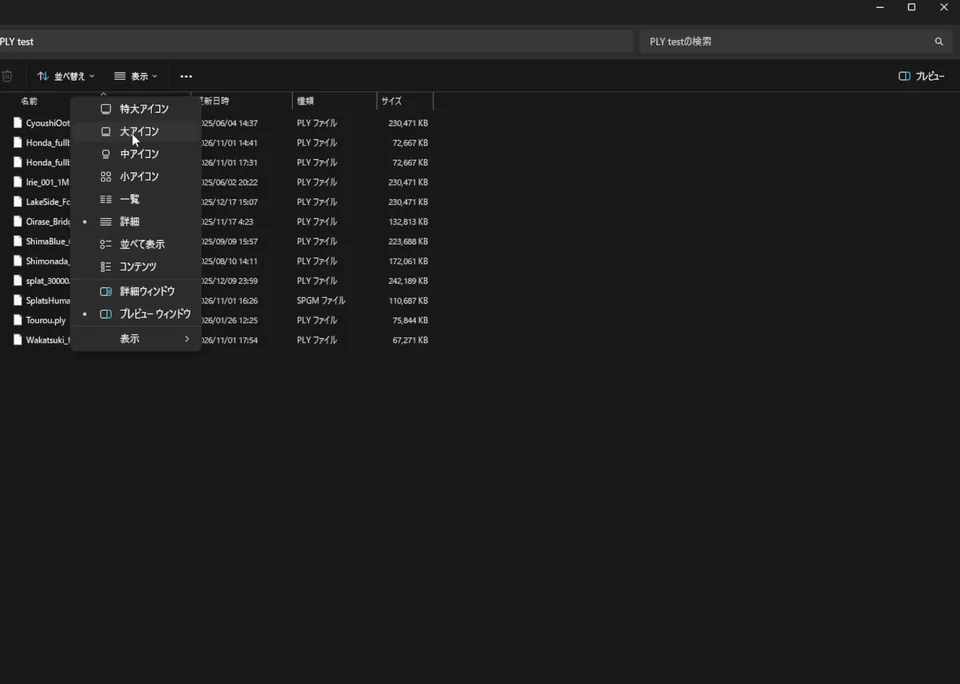
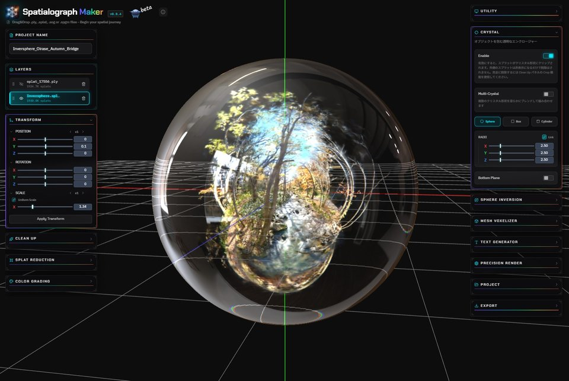

#  SplatThumb

3D Gaussian Splatting のファイルを、通常のエクスプローラー上でサムネイル表示できるようになります。
簡易的なビューワーも備えているので、サムネイル画像のアングルを調整することもできます。

[](LICENSE)


[ダウンロード](../../releases) | [インストール](#インストールとアンインストール) | [視点を決める](#視点を決める) | [安全性](#安全性) |
[Mac 版](#mac-版のインストールと削除) | [ビルド](#ソースからのビルド) | [English](README.md)



SplatThumb は、3D Gaussian Splatting の `.ply` ファイルをエクスプローラー上でサムネイル表示する Windows の拡張機能です。
ファイルのヘッダーを見てスプラットのシーンだけを描き、メッシュや点群の PLY は Windows の標準の表示に任せます。
ファイルは読むだけで書き換えず、ネットワーク通信もテレメトリーもありません。

- 標準(INRIA 形式)と PlayCanvas / SuperSplat の圧縮 PLY を、どのアイコンの大きさでも表示します。
- ファイルごとに、ターンテーブルのように回して視点を決められます。視点はファイルの中身をもとにユーザーのフォルダーに保存し、ファイル自体には書き込みません。
- 大きなシーンは 5 万〜40 万個のスプラットに間引いて素早く描きます。数は全体でもファイルごとでも選べます。
- 対象外のファイルを除外し、決まった上限のチェック、ファジング済みの解析と描画、Windows の別プロセスでの実行でシステムを守ります。
- アンインストールすると、前に登録されていたサムネイルハンドラーまで元に戻します。
- [Spatialograph Maker](https://www.spatialograph.app/) のプロジェクト(`.spgm`)も、アプリが保存したプレビューを表示します。

## Windows 版と Mac 版の違い

Mac 版は v0.5.0 から使えます([Mac 版のインストールと削除](#mac-版のインストールと削除))。
macOS では、ほかのアプリが Finder の `.ply` のサムネイルを置き換えられないため、仕組みが違います。

| | Windows 版 | Mac 版 |
|---|---|---|
| 絵の出し方 | エクスプローラーのサムネイル(すべての `.ply`) | Finder のカスタムアイコン(登録したフォルダの `.ply` にアプリが付ける) |
| いつ | 自動 | フォルダを追加したときと、見張り中(アプリを開いている間だけ、またはログイン項目で常駐) |
| ファイル | 読むだけで書き換えない | 中身は変えないが、アイコンをファイルの拡張属性に保存する(変更日は保つ) |
| 表示される場所 | エクスプローラーのすべての表示 | アイコン表示とリスト表示。Finder のプレビュー欄やクイックルックは Apple 標準のまま |
| コピー | どこにあってもサムネイルを作る | Finder でのコピーにはアイコンも付いていく。exFAT/FAT のドライブ、zip、アップロード、Git では消える |
| 視点を決める | 右クリック →「SplatThumb で視点を設定」 | 右クリック →「このアプリケーションで開く」→「SplatThumb」 |
| 保存した視点 | ファイルの中身をもとにした `.view` ファイル | Windows 版と同じ `.view` ファイル(コピーすれば共通に使える) |
| `.spgm` | サムネイル | サムネイル(クイックルック) |
| 消すとき | 設定からアンインストール。すべて元に戻る | アプリで「登録したフォルダのアイコンをすべて外す」を押してから、アプリを削除 |
| 動作環境 | Windows 10/11 x64 | macOS 13 以降(Apple シリコン、Intel) |

## インストールとアンインストール

動作環境: Windows 10/11 x64。SplatThumb はお使いのユーザーだけにインストールされ、管理者権限は不要です。

1. `SplatThumb-<バージョン>-x64.msi` を実行します。インストーラーにはまだコード署名がないため、
   Windows SmartScreen が「発行元が不明」と警告することがあります。このプロジェクトから入手したファイルであれば、
   「詳細情報」→「実行」を選んでください。
2. 3D Gaussian Splatting の `.ply` があるフォルダーをエクスプローラーで開き、大きいアイコンで表示します。

アンインストールは、「設定」→「アプリ」→「インストールされているアプリ」(Windows 10 では「設定」→「アプリ」→「アプリと機能」)で、SplatThumb の「アンインストール」を選びます。
インストーラーが書いたファイルとレジストリ、保存した視点と設定を消し、インストール前に別の `.ply` や `.spgm` のサムネイルハンドラーが登録されていた場合は、それを元に戻します。

Windows は、一度作ったサムネイルをキャッシュに保存しています。そのため、アンインストール後もしばらくサムネイルが表示されることがあります。
消すには「ディスク クリーンアップ」を開き、「縮小表示」だけにチェックを入れて「OK」を選びます。

## Mac 版のインストールと削除

動作環境: macOS 13 以降(Apple シリコン、Intel)。

1. [リリース](../../releases) から `SplatThumb-<バージョン>-macos.dmg` をダウンロードして開き、SplatThumb を
   「アプリケーション」フォルダにドラッグします。アプリは Apple の公証(notarization)を受けています。
2. SplatThumb を一度開き、「フォルダを追加…」で 3DGS の `.ply` があるフォルダを選びます。
   中の 3DGS の `.ply` に、SplatThumb の絵が Finder のアイコンとして付きます(点群データは変わりません)。
3. 新しいファイルや更新したファイルにも自動で付けるには「登録したフォルダを見張る」をオンにし、
   「アプリを開いている間だけ」か「常駐」(ログイン時に起動してメニューバーで続ける)を選びます。

アングルを決めるには、Finder で `.ply` を右クリックし、「このアプリケーションで開く」→「SplatThumb」を選びます。
アングルを調整して「この視点をサムネイルにする」を押すと、そのアングルでアイコンが作り直されます。

削除するときは、次の順に行います。

1. SplatThumb で「登録したフォルダのアイコンをすべて外す」を押します(付けたアイコンが外れ、ファイルは元どおりになります)。
2. 「常駐」にしていた場合は「アプリを開いている間だけ」に戻します(ログイン項目から外れます)。
3. SplatThumb を終了し、「アプリケーション」フォルダから削除します。
4. 必要なら、残った設定と保存したアングルも削除します:
   `~/Library/Containers/com.voxelkei.splatthumb`、`~/Library/Containers/com.voxelkei.splatthumb.thumbnail`、
   `~/Library/Application Scripts/com.voxelkei.splatthumb`、`~/Library/Application Scripts/com.voxelkei.splatthumb.thumbnail`
   (保存したアングルは最初のフォルダの `Data/Library/Application Support/SplatThumb/views` にあります)。

アイコンはファイルの拡張属性に入っています。exFAT/FAT のドライブや Windows の共有フォルダにコピーすると、
アイコンの代わりに `._` で始まる隠しファイルができることがあります。Windows 側では消してかまいません。

## アップデート

新しいバージョンの `SplatThumb-<バージョン>-x64.msi` を、そのまま上書きでインストールしてください。先にアンインストールする必要はありません。古いバージョンは新しいバージョンに置き換わり、保存した視点と設定はそのまま残ります。インストールの前に、視点設定と設定の画面は閉じておいてください。

すでに表示されているサムネイルは、作り直されるまで前のバージョンのままです。新しいバージョンで作り直したいときは、スタートメニューの「SplatThumb」から「既存のサムネイルを全て再生成する...」を使ってください。

## 視点を決める

自動の視点では構図がよくないファイルは、ファイルごとに視点を決められます。エクスプローラーでファイルを右クリックし、「SplatThumb で視点を設定」を選びます(Windows 11 では「その他のオプションを確認」の中にあります)。

- ドラッグで回転(左右で縦の軸(Y 軸)の周りに回り、上下で見下ろす角度が変わります)、右ドラッグで移動、ホイールで拡大と縮小。
- 「サムネイルに使用するsplats数」で、このファイルのサムネイルに描くスプラットの数(最大 5 万・20 万・40 万個)を選べます。「全体の設定に従う」なら、下の設定画面の数を使います。
- 「この視点をサムネイルにする」で視点(と splats 数)を保存し、サムネイルを作り直してウインドウを閉じます。「リセット」で自動の視点と全体の設定の splats 数に戻ります。「全体の設定...」で、下の設定画面を開きます。

視点はファイルの中身で覚えているので、同じ PC の中なら移動や名前の変更をしても残ります。別の PC にコピーしたファイルには付いていきません。ファイルの中身が変わったときも外れます。保存した視点は `%LOCALAPPDATA%\SplatThumb\views` に、1 ファイルにつき小さなテキストファイル 1 つで置かれます。このフォルダーを消すと、すべてのサムネイルが自動の視点に戻ります(作り直したとき)。アンインストールでも消えます。詳しくは [docs/views-and-settings.md](docs/views-and-settings.md)(英語)にあります。

## 設定

設定画面と視点の画面は、Windows の表示言語に合わせて日本語または英語で表示されます。

スタートメニューの「SplatThumb」から、次のことができます。

- SplatThumb のサムネイルを表示するかどうかの切り替え
- 「サムネイルに使用するsplats数」(最大 5 万・20 万・40 万個)の選択
- 設定を変えたあと、フォルダー(中のフォルダーも含む)の既存のサムネイルを全て作り直す

## サムネイルが表示されるファイル

| ファイル | サムネイル |
| --- | --- |
| 標準(INRIA 形式)の 3D Gaussian Splatting の PLY。バイナリ、リトルエンディアン。多くの学習ツールが出力する形式 | 表示する |
| 上と同じで、法線や `f_rest_*` などの追加の項目があるもの | 表示する(描くのは基本の色だけ) |
| PlayCanvas / SuperSplat の圧縮 PLY(`.compressed.ply`) | 表示する(描くのは基本の色だけ) |
| メッシュ、点群、ASCII やビッグエンディアンの PLY | 表示しない(Windows の通常のアイコン) |
| ほかの形式(`.spz`、`.splat`、`.sog` など) | 表示しない |

大きなファイルは間引いて、最大 20 万個のスプラットを描きます(設定の「サムネイルに使用するsplats数」で 5 万個または 40 万個にもできます)。3 秒以内に描けないときは、Windows の通常のアイコンになります。判別のルールは [docs/detection.md](docs/detection.md)(英語)にあります。

## うまく表示されないとき

**サムネイルがまったく出ない。** エクスプローラーの「…」→「オプション」→「表示」で、「常にアイコンを表示し、縮小版は表示しない」がオフになっているか確かめてください。表示は「大アイコン」などにします。「詳細」や「一覧」ではアイコンしか出ません。

**サムネイルが古い、またはインストール後も出ない。** Windows はキャッシュにあるサムネイルを使い回します。設定の「既存のサムネイルを全て再生成する」を使うか、「ディスク クリーンアップ」で「縮小表示」だけを選んで消してください。

**ほかのアプリのサムネイルが出る。** `.ply`(と `.spgm`)のサムネイルハンドラーは、ユーザーごとに 1 つしか登録できません。SplatThumb より前にほかのアプリが登録していた場合は、SplatThumb が置き換え、アンインストール時に元に戻します。SplatThumb の後にほかのアプリが登録した場合は、そのアプリのサムネイルが使われます。

**3DGS のファイルなのに通常のアイコンになる。** SplatThumb がまだ読めない形式か(上の表)、3 秒以内に描けなかった可能性があります。表示されるはずだと思われる場合は、Issue で報告してください(実際の場所や人が写ったファイルは添付しないでください)。ソースからビルドした場合は、`splatthumb-cli.exe info <ファイル>` で理由を確かめられます。

## 安全性

- ファイルは読み取り専用で開き、書き換えません。保存した視点と設定は、ファイルの中や隣ではなく、お使いのユーザーのフォルダーに置きます。
- ファイルの中の大きさや個数は、使う前に決まった上限と照らし合わせます。壊れたファイルや悪意のあるファイルは、落ちる前に読み込みを断ります。解析と描画の部分は、変更のたびにファジング(でたらめなデータを大量に与えるテスト)で確かめています。
- サムネイルの処理は、エクスプローラー本体ではなく、Windows の別のプロセスで動きます。
- ネットワーク通信、テレメトリー、管理者権限は使いません。
- アンインストールすると、インストーラーが書いたものと、保存した視点と設定をすべて消し、前に登録されていたサムネイルハンドラーがあれば元に戻します。

セキュリティの問題は、公開せずに報告してください。方法は [SECURITY.md](SECURITY.md)(英語)にあります。

## Spatialograph Maker のプロジェクト(.spgm)

<a href="https://www.spatialograph.app/"></a>

SplatThumb は、同じ作者による 3D Gaussian Splatting の編集アプリ [Spatialograph Maker](https://www.spatialograph.app/) のプロジェクトファイルにもサムネイルを表示します。スプラットは描かず、アプリがプロジェクトに保存したプレビュー画像をそのまま表示します。視点と splats 数の設定は効きません。古いバージョンで保存したプロジェクトにはプレビュー画像がないため、通常のアイコンのままです。

## ソースからのビルド

必要なもの: Windows 10/11 x64、Visual Studio 2022(「C++ によるデスクトップ開発」。CMake 3.25 以上が含まれます)

「Developer PowerShell for VS 2022」を開き、リポジトリのフォルダーで次を実行します。

```powershell
cmake --workflow --preset msvc-debug
```

設定、ビルド、テストまでまとめて実行されます。最適化したビルドは `msvc-release` を使います。
ビルドしただけでは Windows には何も登録されません。

ファイルがどう判別されるかを確かめるには、次を実行します(ファイルは読むだけです)。

```powershell
build\msvc\bin\Debug\splatthumb-cli.exe info path\to\scene.ply
```

サムネイルを PNG に書き出すには、次を実行します。

```powershell
build\msvc\bin\Release\splatthumb-cli.exe render path\to\scene.ply thumb.png --size 256
```

背景は暗いグレーです。透過にしたいときは `--background transparent` を付けます。

自分でビルドした DLL をエクスプローラーで試す方法は [docs/dev-registration.md](docs/dev-registration.md)(英語)にあります。インストーラー(MSI)の作り方は [installer/README.md](installer/README.md)(英語)にあります。

## 変更履歴

[CHANGELOG.md](CHANGELOG.md)(英語)にあります。

## 不具合の報告・要望

不具合の報告や要望は [Issues](../../issues) にお願いします(日本語で大丈夫です)。プルリクエストは、今のところ受け付けていません。詳しくは [CONTRIBUTING.md](CONTRIBUTING.md)(英語)にあります。

## 作者

VoxelKei([X: @VoxelKei](https://x.com/VoxelKei))。不具合の報告と要望は、X ではなく [Issues](../../issues) にお願いします。

## ライセンス

[MIT](LICENSE)
