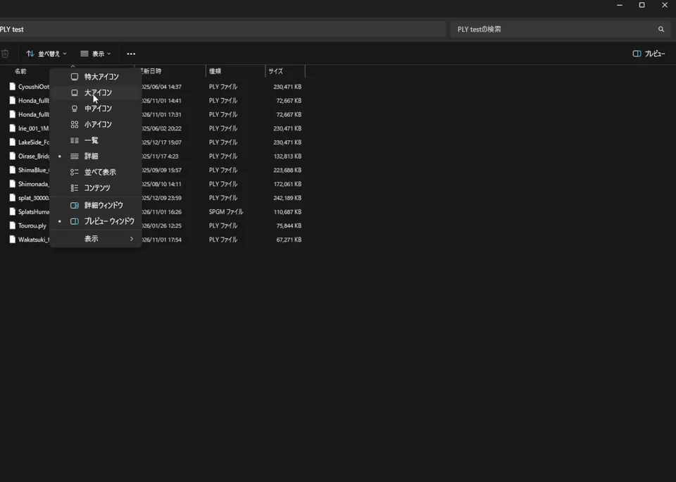
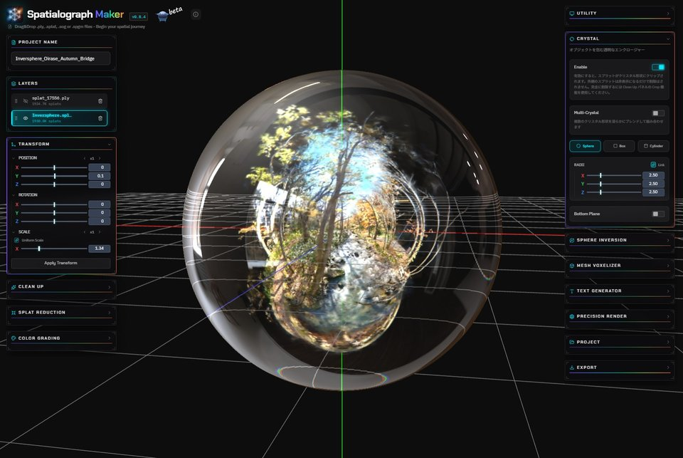

# SplatThumb

See your Gaussian splats in Explorer before you open them.

[](LICENSE)


[Download](../../releases) | [Install](#install-and-uninstall) | [Choosing the view](#choosing-the-view) | [Safety](#safety) |
[Build](#building-from-source) | [日本語](README.ja.md)



SplatThumb is a thumbnail handler for 3D Gaussian Splatting `.ply` files. It recognises splat
scenes from the file header and leaves meshes and point clouds to Windows. Files are only read,
never modified; there is no network access and no telemetry.

- Previews standard (INRIA) and PlayCanvas / SuperSplat compressed PLY at every icon size.
- Lets you pick the view for each file by turning it like a turntable. The view is stored in
  your profile, keyed by the file's contents, and never written into the file.
- Keeps big scenes quick by drawing a sample of 50,000 to 400,000 splats, chosen globally or
  per file.
- Treats every file as untrusted: fixed limits, a fuzz-tested parser and renderer, and Windows'
  separate thumbnail process.
- Uninstalls cleanly, restoring any thumbnail handler that was there before.
- Also shows the preview saved in [Spatialograph Maker](https://www.spatialograph.app/)
  projects (`.spgm`).

## Install and uninstall

Requirements: Windows 10/11 x64. SplatThumb installs for your user account only and needs no
administrator rights.

1. Run `SplatThumb-<version>-x64.msi`. The installer is not code-signed yet, so Windows
   SmartScreen may warn that it is from an unknown publisher. Choose "More info", then
   "Run anyway", only if you got the file from this project.
2. Open a folder with 3D Gaussian Splatting `.ply` files in Explorer and choose large icons.

To uninstall, open Settings > Apps > Installed apps (on Windows 10, Settings > Apps > Apps &
features), and choose Uninstall next to SplatThumb.
Uninstalling removes the files and the registry entries the installer wrote, your saved views
and settings, and puts back the `.ply` and `.spgm` thumbnail handlers that were registered
before, if any.

Windows keeps thumbnails it has already made in its thumbnail cache, so they can still show
after uninstalling. To clear the cache, run Disk Cleanup, check only "Thumbnails", and choose
OK.

## Update

Run the newer `SplatThumb-<version>-x64.msi` over the installed one. There is no need to
uninstall first: the new version replaces the old one, and your saved views and settings are
kept. Close the viewpoint and settings windows before installing.

Thumbnails Windows already made stay as they were until they are made again. To bring a
folder up to date with the new version, open "SplatThumb" from the Start menu and use "Remake
all existing thumbnails...".

## Choosing the view

When the automatic view frames a file badly, you can pick the view for that file. To do so, right-click it in Explorer and choose "Set view with SplatThumb" (on
Windows 11, it is under "Show more options").

- Drag to turn the subject around its vertical (Y) axis or look from higher or lower,
  right-drag to move it, and use the wheel to zoom.
- "Splats used for the thumbnail" picks how many splats this file's thumbnail draws; "Same as
  Settings" follows the settings window.
- "Use this view" saves the view (and the splat count), updates the thumbnail and closes the
  window. "Reset" goes back to the automatic view and the settings window's splat count.
  "Settings..." opens the settings window described below.

The view is remembered by the file's contents, so it stays when you move or rename the file on
the same PC. It does not travel with a copy to another PC, and it is dropped if the file's
contents change.

Saved views are kept in `%LOCALAPPDATA%\SplatThumb\views`, one small text file per file.
Deleting that folder sends every thumbnail back to the automatic view the next time it is
made; uninstalling deletes it too. Details: [docs/views-and-settings.md](docs/views-and-settings.md).

## Settings

The settings and view windows are shown in Japanese or English, following the Windows display
language.

Open "SplatThumb" from the Start menu to:

- turn SplatThumb's thumbnails off or on,
- choose "Splats used for the thumbnail" (up to 50,000, 200,000 or 400,000),
- remake the existing thumbnails in a folder and all folders inside it after changing a
  setting.

## Which files get a thumbnail

| File | Thumbnail |
| --- | --- |
| 3D Gaussian Splatting PLY in the standard (INRIA) layout, binary little-endian, as written by most training tools | Yes |
| The same with extra properties such as normals or `f_rest_*` | Yes (only the base color is drawn) |
| PlayCanvas / SuperSplat compressed PLY (`.compressed.ply`) | Yes (only the base color is drawn) |
| Meshes, point clouds, ASCII or big-endian PLY | No, Windows shows its usual icon |
| Other splat formats (`.spz`, `.splat`, `.sog`, ...) | No |

Large files are sampled: at most 200,000 splats are drawn (50,000 or 400,000 with the "Splats
used for the thumbnail" setting). If a thumbnail cannot be made within 3 seconds, Windows shows its usual icon instead. The detection rules are in
[docs/detection.md](docs/detection.md).

## Troubleshooting

**No thumbnails at all.** In Explorer, open "..." > Options > View and make sure "Always show
icons, never thumbnails" is off. Use a view with large icons; "Details" and "List" show icons only.

**A thumbnail is old, or missing after installing.** Windows reuses thumbnails from its cache.
Use "Remake all existing thumbnails" in the settings, or clear the cache with Disk Cleanup
("Thumbnails" only).

**Another app's thumbnail shows instead.** Only one thumbnail handler can be registered for
`.ply` (or `.spgm`) per user. If another app registered one before SplatThumb was installed, SplatThumb
replaces it and puts it back when uninstalled. If an app registers its own handler after
SplatThumb was installed, that app's handler is used instead.

**A splat file shows the usual icon.** The file may use a layout SplatThumb does not read yet
(see the table above), or be too slow to draw within 3 seconds. If you think it should work,
please open an issue (without attaching the file if it is a real-world scan). If you build from
source, `splatthumb-cli.exe info <file>` shows why.

## Safety

- Files are opened read-only and never modified. Saved views and settings are kept in your user
  profile, not in or next to the files.
- Every size and count in a file is checked against fixed limits before it is used, so a broken
  or malicious file is rejected instead of crashing anything. The parser and renderer are
  fuzz-tested on every change.
- The handler runs in Windows' separate thumbnail process, not inside Explorer itself.
- No network access, no telemetry, no administrator rights.
- Uninstalling removes everything the installer wrote, along with your saved views and settings,
  and restores the previous thumbnail handlers, if there were any.

Please report security problems privately; see [SECURITY.md](SECURITY.md).

## Spatialograph Maker projects (.spgm)

<a href="https://www.spatialograph.app/"></a>

SplatThumb also shows thumbnails for projects of [Spatialograph Maker](https://www.spatialograph.app/), a 3D
Gaussian Splatting editor by the same author. It does not draw the splats: it shows the preview image that the app
saves in the project file (project format version 3), as it is. The view and quality settings
do not apply. Projects saved by older versions have no preview image and keep the usual icon.

## Building from source

Requirements: Windows 10/11 x64, Visual Studio 2022 with "Desktop development with C++"
(includes CMake 3.25 or later).

From a Developer PowerShell for VS 2022, in the repository folder:

```powershell
cmake --workflow --preset msvc-debug
```

This configures, builds, and runs the tests. Use `msvc-release` for an optimized build.
Building does not register anything with Windows.

To check how SplatThumb classifies a file (read-only):

```powershell
build\msvc\bin\Debug\splatthumb-cli.exe info path\to\scene.ply
```

To render a thumbnail to a PNG file:

```powershell
build\msvc\bin\Release\splatthumb-cli.exe render path\to\scene.ply thumb.png --size 256
```

The background is dark gray. Add `--background transparent` for a transparent one.

To try the Explorer thumbnail handler from a local build, see
[docs/dev-registration.md](docs/dev-registration.md). To build the installer (MSI), see
[installer/README.md](installer/README.md).

## Changes

See [CHANGELOG.md](CHANGELOG.md).

## Contributing

Bug reports and ideas are welcome as [issues](../../issues). Pull requests are not accepted for
now; see [CONTRIBUTING.md](CONTRIBUTING.md).

## Author

VoxelKei ([@VoxelKei on X](https://x.com/VoxelKei)). Please send bug reports and requests to
[issues](../../issues), not to X.

## License

[MIT](LICENSE)
